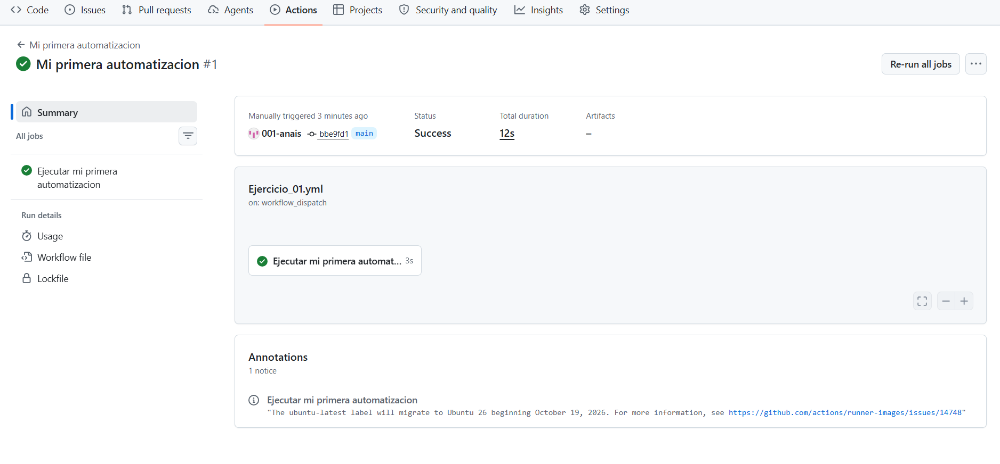
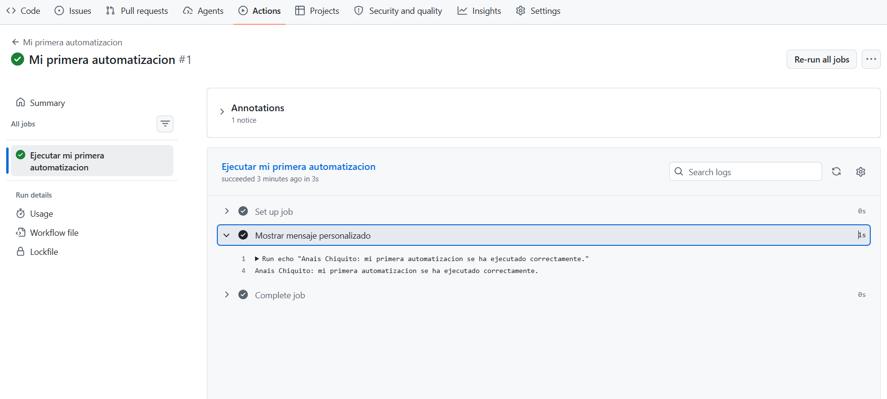

# Ejercicio 01: Mi primera automatización con GitHub Actions

## 1. Enlace al workflow

He creado mi primer workflow en la siguiente ruta:

`.github/workflows/Ejercicio_01.yml`

[Ver archivo Ejercicio_01.yml](../../.github/workflows/Ejercicio_01.yml)

## 2. Configuración elegida

He creado un workflow llamado **Mi primera automatizacion**, que permite iniciar la ejecución manualmente mediante `workflow_dispatch`.

La configuración contiene:

- **Workflow:** Mi primera automatizacion.
- **Job:** Ejecutar mi primera automatizacion.
- **Runner:** ubuntu-latest.
- **Step:** Mostrar mensaje personalizado.

El comando utilizado es `echo`, que permite mostrar un mensaje en el registro de ejecución.

Mensaje personalizado:

`Anais Chiquito: mi primera automatizacion se ha ejecutado correctamente.`

## 3. Ejecución manual

Para comprobar el funcionamiento, he accedido a la pestaña **Actions** de mi repositorio en GitHub.

He seleccionado el workflow Mi primera automatizacion y he pulsado el botón **Run workflow** para iniciarlo manualmente.

La ejecución ha finalizado correctamente con el estado **Success**.

En el log he podido comprobar que aparece el mensaje personalizado que había configurado.

### Evidencia 1: Ejecución correcta

### Evidencia 2: Mensaje en el log

[Consultar ejecución en GitHub](https://github.com/001-anais/practicas-github-actions/actions/runs/44056889926)

## 4. Conclusión

Con este ejercicio he aprendido a crear mi primer workflow de GitHub Actions, configurar su ejecución manual y utilizar un job y un step para ejecutar comandos en un runner de Ubuntu.

También he aprendido a trabajar con ramas, commits y Pull Requests para incorporar los cambios a la rama principal del repositorio.